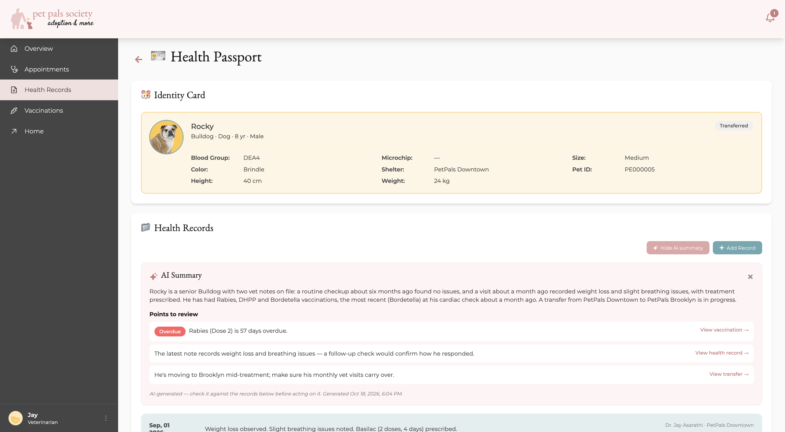
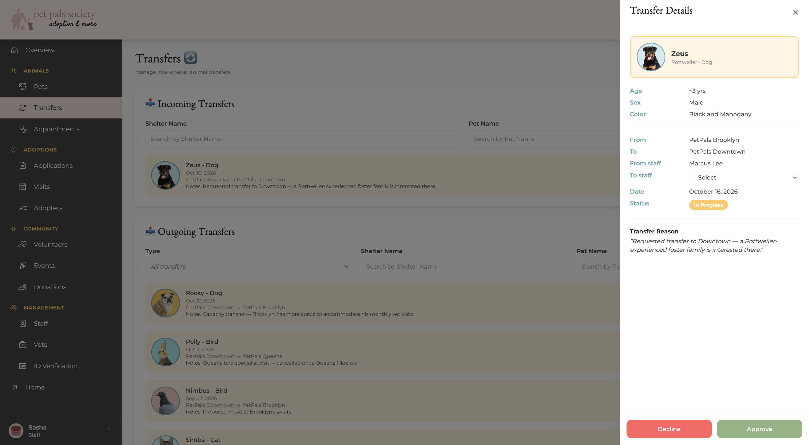
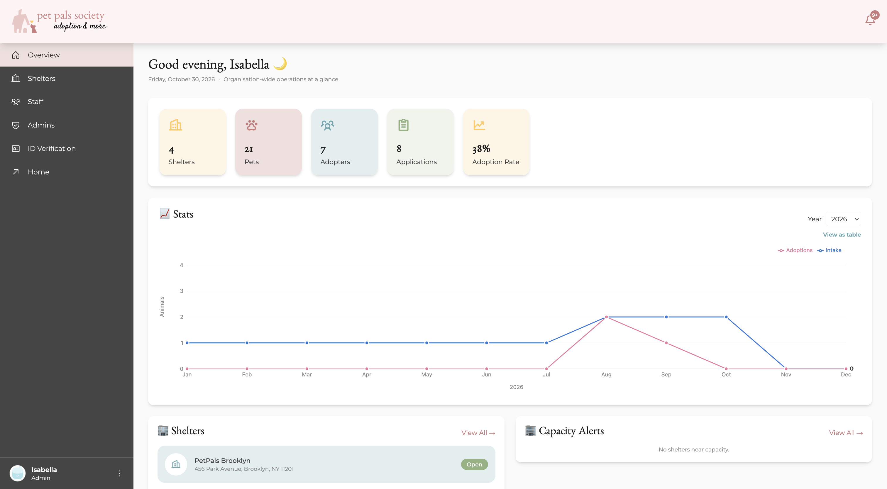
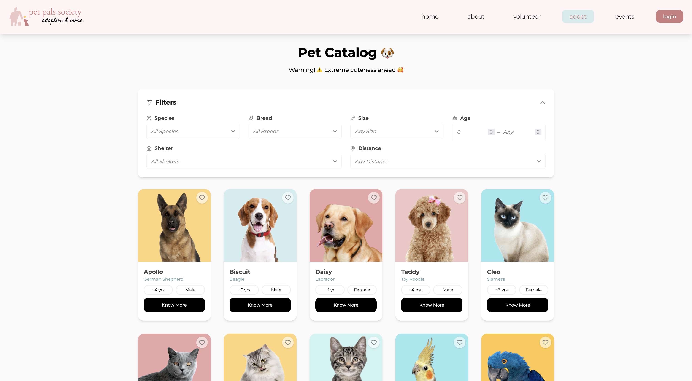
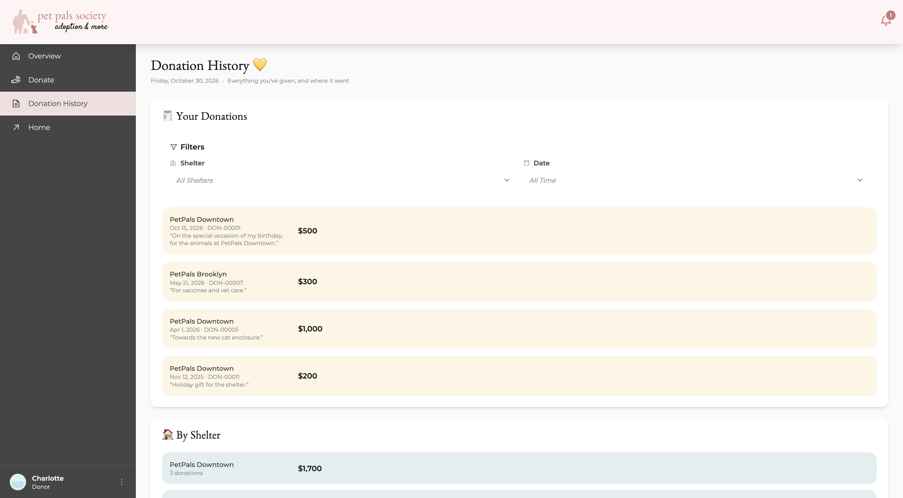
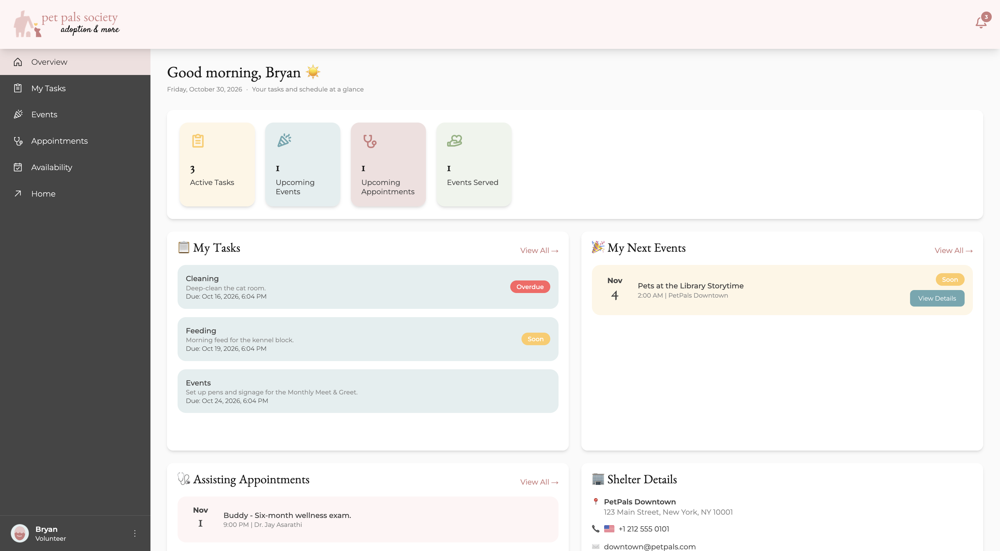
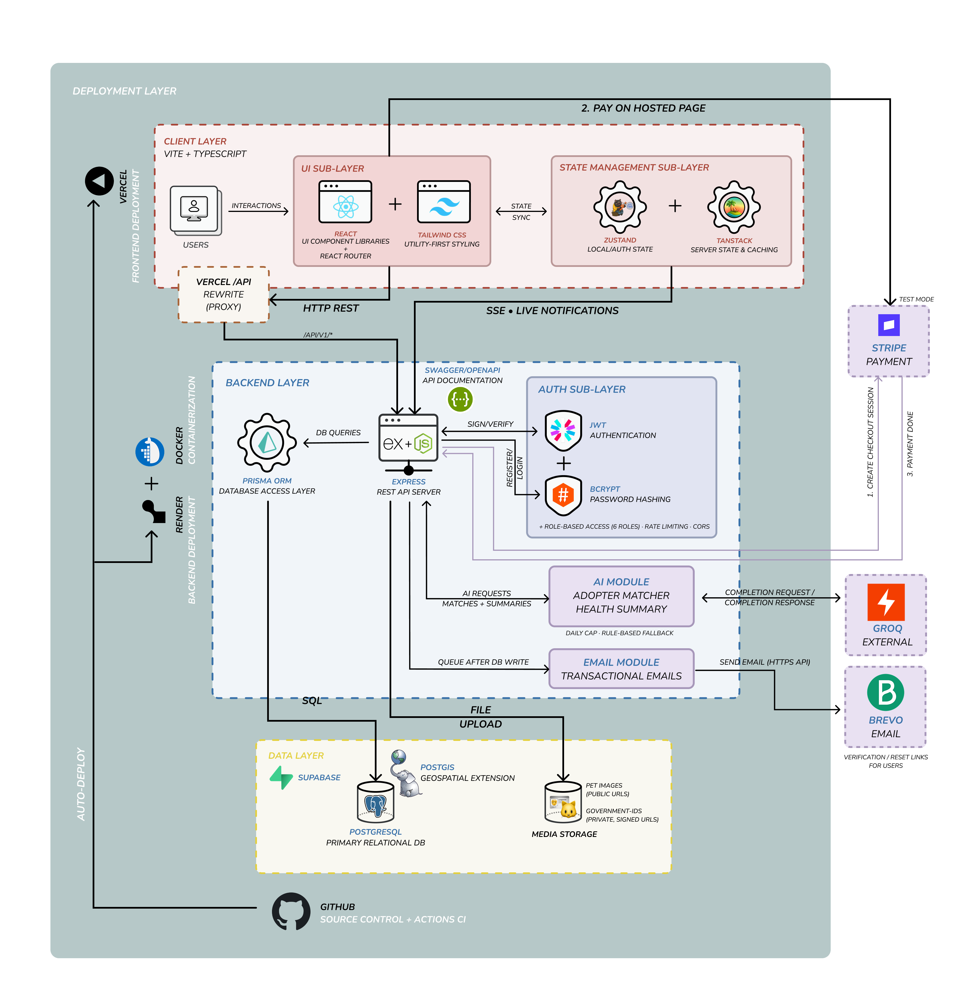

<div align="center">


# PetPals

**A unified, multi-shelter Animal Adoption Management System**

[](https://github.com/karishmahegde/petpals/actions/workflows/ci.yml)
[](./server/jest.config.js)
[](./LICENSE)

</div>

Connecting shelters, adopters, vets, volunteers, and donors on one platform with inter-shelter animal transfers, a universal pet health passport, and AI-powered adopter matching.

<div align="center">

[](https://petpals-adopt.vercel.app)
[](https://petpals-api.onrender.com/api/docs)

</div>

## About the Project

Animal shelters typically operate in isolation. Each branch manages intake, adoptions, and medical records separately, with no shared visibility across locations. Animals get overlooked, applications get lost, and adopters face inconsistent experiences depending on which shelter they contact.

**PetPals** unifies multiple shelters into one network: a shared animal catalog, capacity-aware inter-shelter transfers, and a health passport that follows each animal between locations. Six user roles, an AI adopter matcher with a rule-based fallback, Stripe checkout and real-time notifications sit on top of a Postgres/PostGIS backend.

Built solo, feature by feature in sprints, with a documented spec per feature, PR-gated CI and 2,100+ automated tests.

Detailed documentation for every feature, from the database and API design to the AI features, notifications, testing and security, is in [`docs/`](./docs).

## Live Demo

https://github.com/user-attachments/assets/dd308386-7744-44dd-9ab5-e92771eea029

<p align="center"><sub>Search by ZIP code → AI matches → apply and pay (Stripe test mode) → shelter staff approve → the adopter is notified live.</sub></p>

The live site (linked above) is a portfolio demo. The demo logins below are shared, so anything you do with them is visible to the next visitor; their password, email and account can't be changed. Please don't enter real personal details or upload a real ID.

<details>
<summary><b>Demo logins</b></summary>

| Role      | Email                   | Password        |
| --------- | ----------------------- | --------------- |
| Adopter   | `adopter@petpals.com`   | `Adopter@123`   |
| Volunteer | `volunteer@petpals.com` | `Volunteer@123` |
| Donor     | `donor@petpals.com`     | `Donor@123`     |

Admin, Staff and Vet logins are available on request.

</details>

## Screenshots

<table>
  <tr>
    <td width="50%" valign="top">
      <a href="./docs/assets/screenshots/01-ai-health-passport.png"></a>
      <br /><b>Health passport with AI summary</b><br /><sub>A vet's view of Rocky's passport: the AI summary with points to review, each linked to the record it cites.</sub>
    </td>
    <td width="50%" valign="top">
      <a href="./docs/assets/screenshots/02-transfers.png"></a>
      <br /><b>Inter-shelter transfers</b><br /><sub>Incoming and outgoing transfers between branches, with the approve / decline panel.</sub>
    </td>
  </tr>
  <tr>
    <td width="50%" valign="top">
      <a href="./docs/assets/screenshots/03-admin-overview.png"></a>
      <br /><b>Admin overview</b><br /><sub>Network-wide numbers, monthly intake and adoptions, shelters and capacity alerts.</sub>
    </td>
    <td width="50%" valign="top">
      <a href="./docs/assets/screenshots/04-pet-catalog.png"></a>
      <br /><b>Public pet catalog</b><br /><sub>Every shelter's animals in one catalog, filtered by species, breed, size, age, shelter and distance.</sub>
    </td>
  </tr>
  <tr>
    <td width="50%" valign="top">
      <a href="./docs/assets/screenshots/05-donations.png"></a>
      <br /><b>Donation history</b><br /><sub>A donor's Stripe donations across shelters, with totals per shelter.</sub>
    </td>
    <td width="50%" valign="top">
      <a href="./docs/assets/screenshots/06-volunteer-overview.png"></a>
      <br /><b>Volunteer dashboard</b><br /><sub>Assigned tasks, upcoming events and the appointments they're assisting.</sub>
    </td>
  </tr>
</table>

## Key Features

| Feature                        | Description                                                                      |
| ------------------------------ | -------------------------------------------------------------------------------- |
| **Multi-shelter network**      | One catalog and shared workflows across every branch                             |
| **Inter-shelter transfers**    | Capacity-aware transfers with full history                                       |
| **Universal health passport**  | Medical records that follow an animal from shelter to shelter                    |
| **AI compatibility matcher**   | Personality quiz + rule scoring, refined by an LLM with a reason per match       |
| **AI health-passport summary** | One-click medical summary, with points to review linked to records               |
| **Role-based access control**  | Six roles: Admin, Shelter Staff, Adopter, Veterinarian, Volunteer, Donor         |
| **Geospatial shelter search**  | PostGIS "shelters near me" with a radius filter                                  |
| **Email & account security**   | Verification, password reset, reactivation and email change by link              |
| **Live notifications**         | 28 event types pushed in real time over Server-Sent Events                       |
| **Stripe payments**            | Application fees and shelter donations through Stripe Checkout                   |
| **Security by design**         | Rate limits, hashed single-use links, a daily AI cap - see [Security](#security) |

## Architecture

<p align="center">
  <a href="./docs/assets/architecture.png"></a>
</p>

The browser reaches the API through Vercel's `/api` rewrite, so the login cookie stays on the site's own domain; only the live notification stream connects to Render directly. Stripe confirms payments by webhook, and AI and email are optional add-ons with fallbacks.

## Tech Stack

### Frontend

     

### Backend

     

### Database

  

### Auth

 

### AI


### Testing

    

### Infrastructure

   

### Tooling

[](https://www.figma.com/design/dtiJqWSoBhaMrgrs12fXYK/PetPals)

## Getting Started

### Prerequisites

- **Node.js 22** (20.19+ works - Prisma 7's minimum) and **Git**
- **Docker + Docker Compose** _(Option B only)_
- A free **[Supabase](https://supabase.com)** account - the project's database (Postgres + PostGIS) and file storage both run on it, even in local dev

### Option A: Local Setup (recommended)

```bash
# 1. Clone the repo
git clone https://github.com/karishmahegde/petpals.git
cd petpals

# 2. Configure the server - Supabase and JWT values are required;
#    Stripe, AI and email are optional (see setup/SETUP.md)
cd server
npm install
cp .env.example .env

# 3. Build the database, create the storage buckets, upload the seed photos, load sample data
npm run setup

# 4. Configure the client
cd ../client
npm install
echo "VITE_API_URL=http://localhost:5000/api/v1" > .env.local
```

Then start both dev servers:

```bash
# Terminal 1
cd server && npm run dev      # → http://localhost:5000

# Terminal 2
cd client && npm run dev      # → http://localhost:3000
```

Log in with any of the [demo logins](#live-demo) above; locally every role works.

**[`setup/SETUP.md`](./setup/SETUP.md)** is the full guide: where to find each Supabase value, what `npm run setup` does, the complete test-account list (all six roles), and troubleshooting.

> ⚠️ `npm run setup` is for **first-time setup only** - its last step re-seeds, which wipes the database. Afterwards, re-seed with `npx prisma db seed`.

### Option B: Docker

Docker runs the API and client in containers, but it isn't fully standalone: the database and file storage stay on your Supabase project, and the one-time setup (step 2) still runs on your machine with Node.

```bash
# 1. Configure the server - same values as Option A
cp server/.env.example server/.env

# 2. One-time: build the database, storage buckets and sample data
cd server && npm install && npm run setup && cd ..

# 3. Build and start the API and client
docker compose up --build
```

| Service | URL                   |
| ------- | --------------------- |
| Client  | http://localhost:3000 |
| API     | http://localhost:5000 |

---

## Project Structure

Top-level layout of the repository:

```text
petpals/
├── client/                # React + Vite + TypeScript frontend
├── server/                # Node.js + Express REST API (Prisma + PostgreSQL)
├── setup/                 # Everything needed to get the project running locally
│   ├── SETUP.md           #    Step-by-step setup guide (start here)
│   ├── setup-storage.js   #    Creates storage buckets + uploads seed photos (run by `npm run setup`)
│   ├── pet-images/        #    Seed pet photos, one per seeded pet
│   ├── government-ids/    #    Sample ID documents for the seeded ID verifications
│   └── placeholder.jpg    #    Photo a new pet shows until staff upload one
├── .github/workflows/     # GitHub Actions CI (server unit tests + client checks on every PR)
├── docs/                  # Project documentation PDFs (design, API references, features, testing, security)
├── docker-compose.yml     # Runs the API + client in containers against Supabase - `docker compose up`
├── render.yaml            # Render Blueprint for the hosted API (free plan)
├── CLAUDE.md              # Full architecture, API, and conventions reference
├── LICENSE
└── README.md              # You are here
```

## API Reference

Base URL (production): `https://petpals-api.onrender.com/api/v1`
Base URL (dev): `http://localhost:5000/api/v1`

Interactive Swagger/OpenAPI docs are served at **`/api/docs`** (live link at the top, or locally once the server is running).

### Resource domains

| Domain                    | Base path                                         |
| ------------------------- | ------------------------------------------------- |
| Auth                      | `/auth`                                           |
| Pets (public catalog)     | `/pets`, `/species`, `/breeds`                    |
| Shelters                  | `/shelters`                                       |
| Adopters                  | `/adopters`                                       |
| Adoption Applications     | `/adoption-applications`                          |
| Visits                    | `/visits`                                         |
| Staff operations          | `/staff`                                          |
| Appointments              | `/appointments`                                   |
| Vaccinations              | `/vaccines`, `/appointments/:id/vaccinations`     |
| Health records            | `/health-records`, `/pets/:id/health-records`     |
| Veterinarians             | `/vets`                                           |
| Volunteers                | `/volunteers`                                     |
| Government IDs            | `/government-ids`                                 |
| AI matcher                | `/match-quiz`, `/adopters/me/matches`             |
| AI passport summary       | `/pets/:id/health-passport/summary`               |
| Admin                     | `/admins`, `/analytics`                           |
| Tasks                     | `/tasks`                                          |
| Events                    | `/events`                                         |
| Donors & Donations        | `/donors`, `/donations`                           |
| Shelter Transfers         | `/transfers`                                      |
| Notifications             | `/notifications` (+ `/notifications/stream`, SSE) |
| Payments (Stripe webhook) | `/webhooks/stripe`                                |

## Testing

| Layer              | Tool                           | What it covers                                                                                                                                                                                                     |
| ------------------ | ------------------------------ | ------------------------------------------------------------------------------------------------------------------------------------------------------------------------------------------------------------------ |
| Server unit        | Jest + Supertest               | Every route, controller and service with Prisma, Stripe, storage, AI and email mocked - 2,100+ tests, gated at 80% lines / 70% branches (current figure in the coverage badge)                                     |
| Server integration | Jest + Supertest               | One journey per sprint against the real database, creating and removing its own data                                                                                                                               |
| Client             | Vitest + React Testing Library | Routing and auth logic, password rules, the live notification stream, and the components that guard the adoption flow                                                                                              |
| End-to-end         | Cypress                        | The critical adoption flows in a real browser: login redirect-back, the email-verification gate, applying up to the Stripe hand-off + withdrawing, and a visit confirmed by staff reaching the adopter's bell live |

```bash
# server/
npm run test:unit          # unit tests + coverage; fails below 80% lines / 70% branches
npm run test:integration   # against the database in server/.env
npm run test:leftovers     # read-only report of any test data left behind

# client/
npm test                   # Vitest
npm run typecheck && npm run lint
npm run cypress:open       # needs both dev servers running (cypress:run for headless)
```

Unit tests, typecheck, lint and Vitest also run in CI on every PR; integration and Cypress run locally - they need the database and the dev servers. See [`setup/SETUP.md`](./setup/SETUP.md#running-the-tests) for what each needs.

## Engineering Practices

- **Design first:** all screens designed in Figma before implementation. [View designs](https://www.figma.com/design/dtiJqWSoBhaMrgrs12fXYK/PetPals)
- **Sprints with specs:** 12 sprints planned on a Trello board; every feature has a written spec or design doc in [`docs/`](./docs).
- **Branching:** `feature/sprint-N` → `dev` → `main`, with `dev` and `main` changed only through pull requests.
- **PR-gated CI:** GitHub Actions runs the server unit tests (coverage gate 80% lines / 70% branches) and the client typecheck, lint and Vitest on every pull request; both are required checks.
- **Recorded decisions:** API documented in Swagger, schema changes as versioned migrations, and every security decision with its reasons and limits in the [Security Design document](./docs/19-Security%20Design.pdf).

## Deployment

PetPals runs entirely on free tiers, so hosting it costs nothing.

| Part                    | Host                                          | How                                                                                                                                                                                       |
| ----------------------- | --------------------------------------------- | ----------------------------------------------------------------------------------------------------------------------------------------------------------------------------------------- |
| Client                  | **Vercel** (Hobby)                            | Builds `client/`. [`client/vercel.json`](./client/vercel.json) forwards `/api/*` to the API, so the login cookie stays on the site's own domain, and serves the app for every other route |
| API                     | **Render** (free web service)                 | Runs [`server/Dockerfile`](./server/Dockerfile) from the [`render.yaml`](./render.yaml) Blueprint, applying any new database migrations on startup                                        |
| Database + file storage | **Supabase** (free)                           | Postgres + PostGIS and the photo / ID buckets, reached through Supabase's Session pooler                                                                                                  |
| Payments · email · AI   | **Stripe** (test mode) · **Brevo** · **Groq** | Free tiers; email and AI are optional                                                                                                                                                     |
| Uptime monitoring       | **UptimeRobot** (free)                        | Calls `GET /api/v1/species` every 10 minutes, so the API never sleeps and the database stays active                                                                                       |

> ⏳ On their own, the free API sleeps after 15 minutes without traffic (a 30–60 second first load) and a free Supabase project pauses after about a week without activity. The UptimeRobot ping keeps both awake, and alerts by email if the API goes down.

To deploy your own copy:

1. **API:** Render → **New → Blueprint** → this repo. Fill in the values it asks for from your `server/.env`, using Supabase's **Session pooler** URI for `DATABASE_URL` (see [`setup/SETUP.md`](./setup/SETUP.md#2-create-a-supabase-project)) and your Vercel URL for `CLIENT_URL`.
2. **Client:** point the `/api` rewrite in `client/vercel.json` at your Render URL, then import the repo into Vercel with root directory `client/`, `VITE_API_URL=/api/v1` and `VITE_STREAM_URL=https://<your-api>.onrender.com/api/v1`.
3. **Keep-awake (optional):** add a free UptimeRobot HTTP(s) monitor on `https://<your-api>.onrender.com/api/v1/species` with a 10-minute interval.

## Security

Designed in from the start and hardened before launch. Every decision is detailed in the **[Security Design document](./docs/19-Security%20Design.pdf)**.

- **Sessions:** bcrypt passwords; short-lived access token in memory, refresh token in an `httpOnly`, `SameSite=Strict` cookie
- **Access control:** role checks on every endpoint; users see only their own data, staff only their shelter's
- **Emailed links:** single-use, short-lived and stored only as a hash
- **Abuse protection:** rate limits on login, sign-up, emailed links and AI, plus an app-wide daily AI cap; the shared demo logins can't have their password, email or account changed
- **Data protection:** government IDs in private storage behind short-lived signed links; sensitive fields never returned
- **Payments:** handled by Stripe Checkout, with verified webhook signatures

## License

Distributed under the MIT License. See [`LICENSE`](./LICENSE) for details.

---

<div align="center">
Made with 🐾 by <a href="https://github.com/karishmahegde">Karishma</a>
</div>
